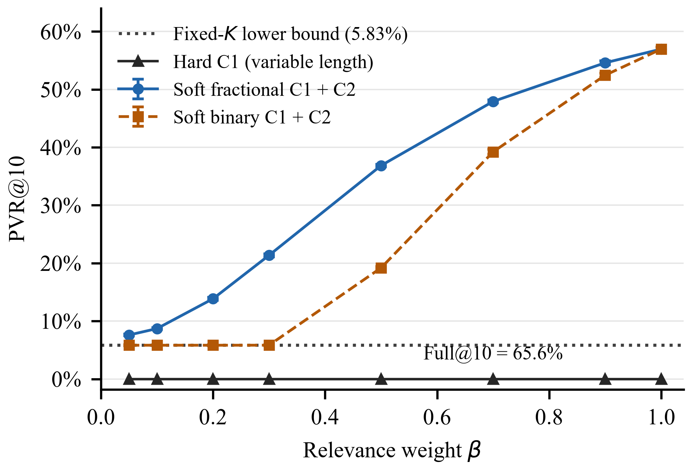

# Eligibility Before Ordering

## Prerequisite-Safe Educational Recommendation with Feasibility-Aware Evaluation

This repository contains the simulation code and numerical results for the paper
**Eligibility Before Ordering: Prerequisite-Safe Educational Recommendation with
Feasibility-Aware Evaluation**.

If fewer than K concepts are eligible, any policy returning K distinct items
from a fixed candidate pool must include ineligible items. The study separates
these unavoidable violations from additional violations introduced by ranking,
and reports the coverage cost of returning only eligible items.

## Scope and policies

- **C1** requires all ancestral prerequisites of a recommended concept to be mastered.
- **C2** applies a soft penalty when difficulty exceeds the learner reference level plus a tolerance.
- **Fixed-length policies** return K distinct candidates.
- **The hard policy** filters candidates using C1, ranks eligible concepts, and returns up to K items.

Mastery is supplied by a synthetic learner generator. The experiments evaluate
a decision layer using simulated scores. Expert-derived weights and training
modifications to recommender models are reserved for future work.

## Main results

The default setting uses a 52-concept, 74-edge curriculum and 5,000 learner
profiles across five learner seeds. Values below are means across seeds.
Soft policies and hard C1 + C2 use beta = 0.30.

| Policy | NDCG@10 | NDCG-F | PVR@10 | Overchallenge | Mean length | Full@10 |
| --- | ---: | ---: | ---: | ---: | ---: | ---: |
| Relevance only | 0.88475 | 0.50656 | 0.56966 | 0.21221 | 10.0000 | 1.000 |
| Soft fractional C1 + C2 | 0.78119 | 0.86159 | 0.21362 | 0.11146 | 10.0000 | 1.000 |
| Soft binary C1 + C2 | 0.71387 | 0.94058 | 0.05834 | 0.09849 | 10.0000 | 1.000 |
| Hard C1 only | 0.67927 | 0.94325 | 0.00000 | 0.09675 | 9.4172 | 0.656 |
| Hard C1 + C2 | 0.67426 | 0.93649 | 0.00000 | 0.09259 | 9.4172 | 0.656 |

Hard C1-only is the hard policy at beta = 1, where the C2 weight is zero.
Adding C2 reduces overchallenge by 0.00416 while decreasing NDCG@10 by 0.00501.
The eligible set and returned list lengths are the same in this comparison.
Sample SDs are included in the CSV summaries linked below.

### Fixed-length bound and excess PVR

For L learners, let C_valid(l) denote the eligible candidate set. If each policy
returns K distinct items and each candidate pool has at least K items, a counting
argument gives

$$
\mathrm{PVR}@K(P) \ge B_K
= \frac{1}{KL}\sum_{l=1}^{L}\max\{0,K-|C_{\mathrm{valid}}(l)|\}.
$$

Excess PVR for a fixed-length policy is

$$
\mathrm{ExcessPVR}(P)=\mathrm{PVR}@K(P)-B_K.
$$

The default bound is **0.05828**. At beta = 0.30, soft binary has excess PVR
**0.00006**, while soft fractional has excess PVR **0.15534**. Soft binary
attains the bound at the tested beta values 0.05, 0.10, and 0.20. At beta = 0.30
it incurs three additional violations across 50,000 recommendation slots.

### Results conditional on eligible candidate availability

The E8 analysis uses the same profiles and groups them by whether at least ten
eligible concepts are available.

| Stratum | Profiles | Fixed-length bound | Soft fractional PVR | Soft binary PVR |
| --- | ---: | ---: | ---: | ---: |
| At least 10 eligible concepts | 3,280 (65.6%) | 0.00000 | 0.16139 | 0.00006 |
| Fewer than 10 eligible concepts | 1,720 (34.4%) | 0.16943 | 0.31323 | 0.16949 |

Rates are averaged within each stratum and learner seed, then across seeds.
Hard C1 has zero PVR in both strata and returns an average of 8.306 items in
the shortfall stratum. Excess PVR is undefined for this variable-length policy.

### PVR sensitivity figure

The plot shows means over five learner seeds and one sample SD for soft policies.
Hard C1 returns only eligible items and provides full Top-10 lists for 65.6% of
profiles. The [vector PDF](extended_results/pvr_sensitivity_ieee.pdf) is also available.

## Reproduce the experiments

Run these commands from the repository root. Python 3.12 is the baseline runtime
target. The dependency file pins NumPy, pandas, and Matplotlib and specifies a
SciPy version range.

~~~bash
python -m pip install -r requirements.txt
python extended_experiments.py --output-dir extended_results
python alignment_experiment.py
python feasible_set_analysis.py
python plot_pvr_sensitivity.py
~~~

The extended experiment runs E1–E5. The alignment script runs E7, the feasible-set
script runs E8, and the plotting script regenerates the figure from the main CSV.
These commands overwrite their corresponding result files.

For a smaller smoke run, use a separate output directory

~~~bash
python extended_experiments.py --quick --output-dir quick_results
~~~

Quick mode uses 200 learners per seed and two learner seeds. Its results differ
from the full-run paper results.

The original three-policy simulation can be reproduced separately

~~~bash
python conference_simulation.py --output-dir simulation_results
~~~

## Artifact map

| File | Purpose |
| --- | --- |
| [conference_simulation.py](conference_simulation.py) | Curriculum and learner generators, original simulation, and shared constants |
| [extended_experiments.py](extended_experiments.py) | Ablations, soft comparators, NDCG-F, graph variation, and parameter sensitivity |
| [alignment_experiment.py](alignment_experiment.py) | Difficulty assignment sensitivity and macro/micro overchallenge comparison |
| [feasible_set_analysis.py](feasible_set_analysis.py) | PVR and excess PVR stratified by eligible candidate availability |
| [plot_pvr_sensitivity.py](plot_pvr_sensitivity.py) | Paper figure as PNG and PDF |
| [requirements.txt](requirements.txt) | Python dependencies |

| Result file under extended_results/ | Analysis |
| --- | --- |
| [E1_E3_main_by_beta.csv](extended_results/E1_E3_main_by_beta.csv) | Main results, binary/fractional and matched-C2 comparators, and beta sweep |
| [E1_by_stage.csv](extended_results/E1_by_stage.csv) | Early, intermediate, and advanced learner profiles |
| [E4_other_graphs.csv](extended_results/E4_other_graphs.csv) | Additional curriculum graphs and edge densities |
| [E5_sensitivity_delta_q.csv](extended_results/E5_sensitivity_delta_q.csv) | Difficulty tolerance and ability quantile grid |
| [E7_difficulty_alignment.csv](extended_results/E7_difficulty_alignment.csv) | Difficulty noise and a single shuffled assignment |
| [E8_feasible_set_strata.csv](extended_results/E8_feasible_set_strata.csv) | Sufficient-candidate and shortfall strata |

Experiment identifiers retain their numbering from the revision workflow.
E6 is absent from this release.

The original graph, metadata, configuration, and summaries are under
[simulation_results/](simulation_results/). The extended script also generates
intermediate learner-level pickle files. The original learner-level CSV is
regenerated by the baseline script and excluded from version control.
Local manuscript drafts are kept in the ignored doc/ directory.

### Variant names in the extended CSV files

| CSV variant | Interpretation |
| --- | --- |
| relevance_only | Noisy base relevance ranking over unseen concepts |
| hard_c1_c2, beta = 1 | Hard C1-only ablation |
| hard_c1_c2, beta < 1 | Hard C1 filtering with C2 ordering |
| soft_frac_c1 | Fractional unmet-ancestor penalty plus C2 |
| soft_bin_c1 | Binary prerequisite violation penalty plus C2 |
| soft_frac_c1_fullC2 | Fractional C1 with the C2 coefficient matched to the hard rule |

The original simulation uses hard_c1_then_c2 and soft_c1_c2 for its hard and soft
combined variants.

## Evaluation definitions

- **NDCG@10** uses gain 2^g − 1 from latent learner–concept affinity, logarithmic
  position discounts, and an ideal over all unseen candidates.
- **NDCG-F** gives invalid items zero gain at their original positions and uses
  an ideal over eligible candidates.
- **PVR@K** is the invalid-item proportion in each returned list.
- **Overchallenge** is the mean positive difficulty excess beyond the learner
  reference level and tolerance.
- **Len** and **Full@10** report mean list length and the proportion of lists returning ten items.

Both NDCG variants score empty lists or zero-ideal cases as zero. PVR and
overchallenge are averaged over nonempty lists within each learner seed.
Coverage metrics include empty lists. Main CSVs report means and sample SDs
across learner seeds. In the five-graph summary reported in the paper, SDs are
computed across graph-level means.

## Simulation settings

| Parameter | Default |
| --- | --- |
| Concepts and layers | 52 concepts in four layers |
| Prerequisite edges | 74 |
| Main graph seed | 20260904 |
| Learner seeds | 20260904–20260908 |
| Learners per seed | 1,000 |
| Mastered concepts by stage | 8, 22, 38 |
| Requested list length | K = 10 |
| Learner reference level | 75th percentile of mastered-concept difficulty |
| Difficulty tolerance | delta = 0.08 |
| Main beta sweep | 0.05, 0.10, 0.20, 0.30, 0.50, 0.70, 0.90, 1.00 |

## Interpretation and limitations

The graphs are synthetic, mastery is binary and prerequisite-closed, and
relevance is simulated. Base scores combine the same latent affinity used for
evaluation gains with popularity and noise. Numerical ranking advantages must
be interpreted within that design.

Zero PVR follows from enforcing the supplied eligibility rule. The reported
effects concern ranking, prerequisite compliance, and list coverage under the
evaluated conditions. Learner outcomes and real-world predictive performance
require further evaluation.

The main generator aligns difficulty with curricular progression. The C1 share
of overchallenge reduction falls from 96.5% to 84.9% in the higher-noise setting.
The E7 noise sweep changes both the assignment and the marginal distribution of
difficulty, and its reported Spearman correlation uses concept index. The
shuffled condition is one realization. When total overchallenge increases, the
C1 ratio has no interpretation as a share of a reduction.

## Version used for the numerical results

[Commit 065853e](https://github.com/syamsudintekno/two_stage_curriculum_constrained/tree/065853ee95b67b676005d77d6dc7a4d00a85a6e4)
contains the experiment scripts, E1–E5/E7/E8 summaries, and figure artifacts used
for the revised manuscript. Later documentation updates may change the default
branch README.
